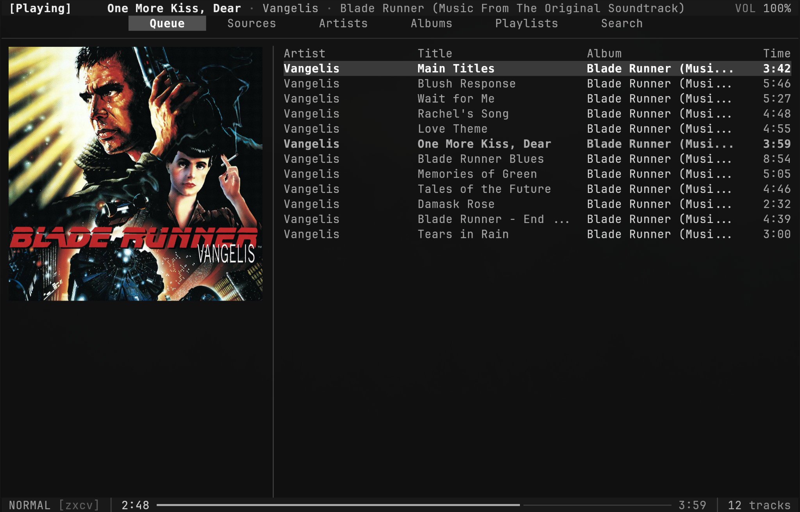

# rusty spotify player client

I like rmpc's interface, but most of my music is on Spotify. rspc keeps that
interface and adds Spotify alongside local files and streams from MPD, all in
one queue.



## install

Supports Linux x86-64, Linux AArch64 and Apple Silicon macOS 13 or newer. Native
Windows and Spotify playback on Intel Macs are not supported.

Homebrew publication is pending. Both packages below also install Spotify's
Soloist player:

| package manager      | command                                         |
| -------------------- | ----------------------------------------------- |
| Homebrew             | `brew install --cask nathanaelluke/tap/rspc`    |
| Nix, from a checkout | `nix profile add .#rspc --max-jobs 1 --cores 1` |

[GitHub Releases](https://github.com/nathanaelluke/rspc/releases) will provide
binaries and `SHA256SUMS`. Verify your download, then copy both executables from
`bin/` to a directory on PATH and the contents of `share/` to `~/.local/share/`.
Linux binaries require OpenSSL 3 and glibc 2.35 on x86-64 or 2.39 on AArch64. On
macOS, install OpenSSL with `brew install openssl@3`. On NixOS, use the Nix
package.

To build from source, install stable Rust, a C compiler, `pkg-config` and
OpenSSL development headers, or enter `nix develop` after cloning:

```sh
git clone https://github.com/nathanaelluke/rspc.git
cd rspc
cargo build --release --locked -j1 -p rspc -p rspc-ui
./scripts/install.sh
```

The installer puts both executables in `~/.local/bin`. Source and archive
installs need Soloist separately: use `brew install --cask spotify-soloist`,
`nix profile add .#soloist`, or
[Spotify's downloads](https://developer.spotify.com/documentation/soloist/reference/downloads-and-updates).
Put it on PATH or set `RSPC_SOLOIST_PATH`. rspc starts the player itself. Linux
playback needs PipeWire or PulseAudio.

## spotify setup

You need Spotify Premium and your own
[Soloist API key](https://developer.spotify.com/dashboard/soloist). Save the key
in `~/.config/rspc/soloist-api-key`, restrict it with `chmod 600`, then run:

```sh
rspc login
rspc
```

Follow the authorization shown in the terminal. Use `rspc login --repair` to
repair an expired or revoked audio session; it interrupts playback. Soloist
builds expire after 90 days, so keep the player package current.

## usage

```sh
rspc                          # open the interface
rspc -- add /path/to/song.flac
rspc -- add https://example.org/stream
rspc --local                  # use your existing MPD queue directly
rspc doctor                   # inspect player state and errors
rspc stop                     # stop the daemon and playback
```

Local files and streams need MPD 0.24 or newer. rspc uses a separate partition
and reads MPD settings from `~/.config/rmpc/config.ron` or `--config`. Override
them with `RSPC_MPD_ADDRESS`, `RSPC_MPD_PASSWORD` and `RSPC_MPD_OUTPUT`. MPD is
optional for Spotify-only use. Switching between players has a short gap.

## configuration

Config lives in `~/.config/rspc/config.ron`, with themes in `themes/`. Themes,
layouts and keybindings use rmpc 0.11's RON format. See the
[shipped defaults](config/) and
[rmpc documentation](https://rmpc.mierak.dev/configuration/). Use `--config` for
an existing config. Spotify options live under `spotify`.

Caches live in `~/.cache/rspc`; queue state, pairing and logs in
`~/.local/state/rspc`. XDG overrides are supported. Keep keys and pairing state
private, and inspect logs for paths and library metadata before sharing.

## development

Use `nix develop` for build dependencies and MPD, then `make check` for tests,
formatting and Clippy. Live Spotify tests require `--ignored` and a saved login.

Release tools live in `crates/xtask`: `check-release --history` scans for
private data, `licenses` refreshes the third-party notices after dependency
changes, and `update-soloist --write` refreshes Nix's player checksums. Run them
with `cargo run --locked -p xtask -- <command>`. Version tags create draft
releases.

The frontend derives from [rmpc](https://github.com/mierak/rmpc); protocol
libraries come from [librespot](https://github.com/librespot-org/librespot). See
[NOTICE](NOTICE) and the license files for attribution. rspc is not affiliated
with Spotify or its upstream projects.
